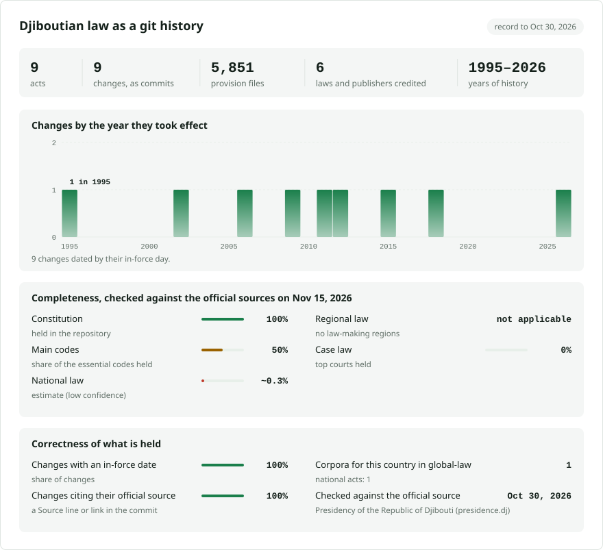

# Djibouti: law history in git

[Français](README.md) · **English**

<picture>
<source media="(prefers-color-scheme: dark)" srcset="data/effort-dark.svg">

</picture>

The law of Djibouti as a git history: one file per article, one commit per version on the day it took effect, and the law that made each change as the commit's author. `git blame` names the law behind every article; `git log` lists every change to an article; picking a date gives the text in force that day.

Part of [lexifina/global-law](https://github.com/lexifina/global-law), one git history for every country's law: this is Djibouti's national law, which global-law reads at `djibouti/national/acts/`.

**What is in it now:** 9 acts, each in one version: the Constitution, as the Presidency's website showed it on 29 October 2026; six codes as adopted or enacted, the Code civil (2018, 2,411 articles), Code de commerce (2012, 2,152), Code pénal (1995, 555), Code du travail (2006, 299), Code de la famille (2002, 222) and Code de protection juridique des mineurs (2015, 90); and two laws amending the Code du travail (2009 and 2011), kept as their own files and not applied to it. [`REPRODUCE.md`](REPRODUCE.md) lists every act with its version and says how the files were made; each act's folder has a README listing its articles.

Each act is a folder, one file per article: `code-du-travail/art-041.md` is Article 41 of the Code du travail. The Code de commerce's files carry its L. numbers (`code-de-commerce/art-l-0214-006.md` is Art. L.214-6), the Constitution's Preamble and Titres have their own files (`constitution/preamble.md`, `constitution/titre-01.md`), and each amending law is one file (`loi-61-an-09/texte.md`).

The text is in French, as the sources print it; under article 93 of the Constitution the French text prevails. The Arabic text is not part of this record, and neither is an English translation.

## Questions as git commands

| Question | Command |
| --- | --- |
| Every change to Article 1 of the Code du travail | `git log -p --word-diff -- code-du-travail/art-001.md` |
| Which law wrote each line of Article 1? | `git blame code-du-travail/art-001.md` |
| Every version of the Code du travail, with the day each took effect | `git log --format="%h %(trailers:key=In-force,valueonly,separator=) %an" -- "code-du-travail/art-*"` |
| Article 1 as in force on 1 January 2020 | `python tools/on.py 2020-01-01 code-du-travail art-001` |

**Outside git**, we also host this record publicly, for free:

- **[Ask Claude about Djiboutian law](https://global-law.lexifina.com/v1/try_claude?country=djibouti)**: opens Claude with a first question ready.
- **[Ask ChatGPT](https://global-law.lexifina.com/v1/try_chatgpt?country=djibouti)**: the same question in ChatGPT.
- **[Search Djiboutian law on our site](https://lexifina.com/law?country=djibouti&q=cong%C3%A9+pay%C3%A9)**: a search for "congé payé", with each provision's text and its versions, no account needed.
- **[Developer REST API](https://global-law.lexifina.com/v1/search_law?query=cong%C3%A9+pay%C3%A9&jurisdiction=djibouti)**: the same search as JSON, with no key. See the [documentation here](https://lexifina.com/api/global-law).

Both assistants read the record through the free Global law connector (MCP, `https://global-law.lexifina.com/mcp`); the first time, the chat gives you the link that adds it. Ask in French or in English.

**Host it yourself easily.** All it takes is git and Python, and the tools run on your machine:

```sh
git clone --depth 1 https://github.com/lexifina/global-law && cd global-law
python3 tools/countries.py add djibouti/national/acts
python3 tools/law.py show 2026-01-01 djibouti/national/acts/code-du-travail/art-001.md
```

Opened in Claude Code, Cursor, VS Code or Codex, the clone also starts a local MCP server with the same tools ([MCP.md](https://github.com/lexifina/global-law/blob/main/MCP.md)).

## Dates

Each commit is dated at noon, Africa/Djibouti, on the day the version took effect, and carries it in its `In-force:` trailer:

- the Code du travail, the Code de la famille and the Code de protection juridique des mineurs, by the date the Journal officiel gives the law, its promulgation (a law was then executory on promulgation, under article 1 of the Code civil in force at the time); the Journal officiel edition's date is the `Published:` trailer;
- the Code civil by its promulgation (12 April 2018), the Code de commerce by its promulgation and entry into force (1 August 2012), and the Code pénal by the date of the law it is cited by (5 January 1995);
- the two amending laws by the day their article 2 gives (29 January 2009, before law 61/AN/09 was signed, and 16 February 2011);
- the Constitution, whose page gives no date, by the day it was read (29 October 2026).

The Code du travail, the Code de la famille, the Code de protection juridique des mineurs and the two amending laws are credited to the law that enacted them (`Loi n° 133/AN/05/5ème L`). The Constitution and the Codes civil, de commerce and pénal are the oldest versions available and are credited to the publisher, `Presidency of the Republic of Djibouti (presidence.dj)` (`Kind: publisher`), whichever site the text came from. The committer is Lexifina.

## How it is checked

- `tools/check_repo.py` reads every version back from git on the day it took effect and on the day before and compares it with the corpus, whose hash is in `data/corpus.sha256`; it also checks that every commit's trailers parse, that `main` has no merge commits and that no commit is dated in the future. [`REPRODUCE.md`](REPRODUCE.md) records 9 versions of 9 acts read back with no mismatch.
- `tools/build.py` writes the history from that one corpus file, and the same corpus gives the same commit hashes; no second build has been compared yet.
- Nothing in the text is repaired: misprinted article numbers in the Code de commerce, and law 109/AN/10's own numbering, are kept as printed.
- History is append-only: the two amending laws were added as new commits after the first build, not written into it.
- [vulnerabilities/](vulnerabilities/README.en.md): possible drafting mistakes in this law, found by global-law's detectors and checked by hand. Not run yet.

## What it does not show

- **Later amendments.** None is applied: not the laws amending the Code du travail from 2009 to 2025 (two of them are here as their own files only), the Code civil (2019), the Code de commerce (2018 and 2019) or the Code de la famille (2014, whose published text is incomplete).
- **The Constitution as adopted in 1992**, or its revisions: the Presidency's page gives the current text with no date and no list of the revisions it includes.
- **When the Code pénal was consolidated.** The FAOLEX PDF does not say, so later amendments may be in it; its Livre V (contraventions) is left out.
- **Other statutes and decrees.** The Journal officiel publishes acts as enacted, with no consolidated text.
- **The Arabic text**, which prevails for the Code de la famille (its article 220).
- **The codes' headings** (Livres, Titres, Chapitres, Sections), tables of contents and the Constitution's index; in the Codes civil, de commerce and pénal, paragraph breaks are rebuilt from the PDF's line layout.

## Sources

| Source | Kind | Past versions | Notes |
| --- | --- | --- | --- |
| [Journal officiel de la République de Djibouti](https://www.journalofficiel.dj) (Secrétariat général du Gouvernement) | Official gazette | no, each law as enacted | Code du travail, Code de la famille, Code de protection juridique des mineurs, laws 61/AN/09 and 109/AN/10; read on 30 October 2026 |
| [Presidency of the Republic](https://www.presidence.dj/page/constitution) | The Constitution, current text | no, one undated text | Read on 29 October 2026 |
| [WIPO Lex](https://www.wipo.int/wipolex/en/members/profile/DJ) | Official texts republished as PDF | no, the text as adopted | Code civil (DJ026), Code de commerce (DJ023); read on 30 October 2026 |
| [FAOLEX](https://faolex.fao.org/docs/pdf/dji244285.pdf) (FAO) | Text republished as PDF | no, one undated text | Code pénal; read on 30 October 2026 |

## Licence

See [`LICENSE`](LICENSE). The Constitution is published by the Presidency for public use, and this repository makes no claim over it; the codes and the two laws are copied from the Journal officiel, WIPO Lex and FAOLEX, whose pages state no licence.

No AI model wrote, translated or corrected legal text; the scripts were written by AI models, and no model runs when the history is built (see [`REPRODUCE.md`](REPRODUCE.md)).

## Visualisations

- [visualisations/](visualisations/README.en.md): charts drawn from this repository. Not drawn yet.

## More

From [lexifina/global-law](https://github.com/lexifina/global-law):

- [FEATURES.md](https://github.com/lexifina/global-law/blob/main/FEATURES.md): every feature, and what every corpus must support (`git blame`, `law.py`, the MCP tools)
- [FAQ.md](https://github.com/lexifina/global-law/blob/main/FAQ.md): questions and answers · [CONTRIBUTING.md](https://github.com/lexifina/global-law/blob/main/CONTRIBUTING.md): proposing changes · [MCP.md](https://github.com/lexifina/global-law/blob/main/MCP.md): the MCP server · [REPRODUCE.md](https://github.com/lexifina/global-law/blob/main/REPRODUCE.md): how it was built · [CHANGELOG.md](https://github.com/lexifina/global-law/blob/main/CHANGELOG.md)
- [FRESHNESS.md](https://github.com/lexifina/global-law/blob/main/FRESHNESS.md): how current each corpus is · [Monitoring](https://github.com/lexifina/global-law/tree/main/monitoring): whether updates are running · [WATCHING.md](https://github.com/lexifina/global-law/blob/main/WATCHING.md): how each official source is watched for changes
- [performance/](https://github.com/lexifina/global-law/tree/main/performance): how fast the tools are, measured
- [visualisations/](https://github.com/lexifina/global-law/tree/main/visualisations): charts and bridges across the world's law
- [Vulnerabilities](https://github.com/lexifina/global-law/tree/main/vulnerabilities): mistakes in legislation as published
