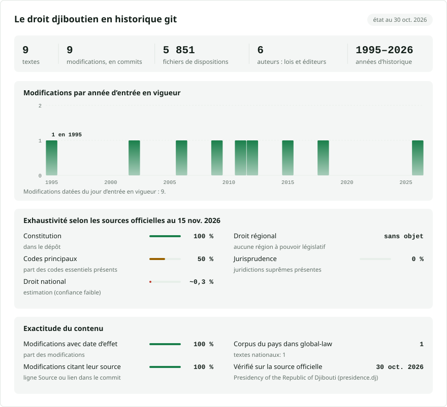

# Djibouti : l’historique du droit dans git

**Français** · [English](README.en.md)

<picture>
<source media="(prefers-color-scheme: dark)" srcset="data/fr/effort-dark.svg">

</picture>

Le droit djiboutien sous forme d’historique git : un fichier par article, un commit par version au jour de son entrée en vigueur, et pour auteur de chaque commit la loi qui a apporté la modification. `git blame` désigne la loi à l’origine de chaque article ; `git log` énumère toutes les modifications d’un article ; le choix d’une date donne le texte en vigueur ce jour-là.

Fait partie de [lexifina/global-law](https://github.com/lexifina/global-law), un historique git unique pour le droit de chaque pays : ce dépôt contient le droit national djiboutien, que global-law lit dans `djibouti/national/acts/`.

**Contenu actuel :** la Constitution (texte actuel, et celle de 1992 telle que promulguée) ; sept codes (civil, commerce, pénal, procédure pénale, travail, famille, protection des mineurs) ; et 23 174 textes du Journal officiel tels que publiés : 2 522 lois, 211 ordonnances, 4 544 décrets, 14 244 arrêtés, 1 334 décisions et délibérations, et 319 autres textes (accords, rectificatifs, déclarations, résolutions). [`STRUCTURE.md`](STRUCTURE.md) décrit l’arborescence et les règles de date ; le dossier de chaque texte contient un README.

Chaque texte est un dossier, avec un fichier par article : `codes/code-du-travail/art-041.md` est l’article 41 du Code du travail ; les lois sont rangées par année (`lois/2024/130-an-24-organisation-et-fonctionnement-des-associations/`), de même que les ordonnances, décrets et arrêtés. Les fichiers du Code de commerce portent ses numéros en L. (`codes/code-de-commerce/livre-2/art-l-0214-006.md` est l’art. L.214-6), le préambule et les titres de la Constitution ont leurs propres fichiers (`constitution/preamble.md`, `constitution/titre-01.md`), et une loi sans articles forme un seul fichier (`lois/2009/061-an-09-modification-partielle-article-295-code-du-travail/texte.md`).

Le texte est en français, tel que l’impriment les sources ; aux termes de l’article 93 de la Constitution, le texte français fait foi. Le texte arabe ne fait pas partie de ce registre, pas plus qu’une traduction anglaise.

## Questions sous forme de commandes git

| Question | Commande |
| --- | --- |
| Toutes les modifications de l’article 1er du Code du travail | `git log -p --word-diff -- codes/code-du-travail/art-001.md` |
| Quelle loi a écrit chaque ligne de l’article 1er ? | `git blame codes/code-du-travail/art-001.md` |
| Toutes les versions du Code du travail, avec le jour d’entrée en vigueur de chacune | `git log --format="%h %(trailers:key=In-force,valueonly,separator=) %an" -- "codes/code-du-travail/art-*"` |
| L’article 1er tel qu’en vigueur le 1er janvier 2020 | `python tools/on.py 2020-01-01 codes/code-du-travail art-001` |

**En dehors de git**, nous hébergeons aussi ce registre publiquement, gratuitement :

- **[Interroger Claude sur le droit djiboutien](https://global-law.lexifina.com/v1/try_claude?country=djibouti)** : ouvre Claude avec une première question prête.
- **[Interroger ChatGPT](https://global-law.lexifina.com/v1/try_chatgpt?country=djibouti)** : la même question dans ChatGPT.
- **[Rechercher dans le droit djiboutien sur notre site](https://lexifina.com/law?country=djibouti&q=cong%C3%A9+pay%C3%A9)** : une recherche de « congé payé », avec le texte de chaque disposition et ses versions, sans compte.
- **[API REST pour les développeurs](https://global-law.lexifina.com/v1/search_law?query=cong%C3%A9+pay%C3%A9&jurisdiction=djibouti)** : la même recherche en JSON, sans clé. Voir la [documentation ici](https://lexifina.com/api/global-law).

Les deux assistants lisent le registre au moyen du connecteur gratuit Global law (MCP, `https://global-law.lexifina.com/mcp`) ; la première fois, la conversation vous donne le lien qui l’ajoute. Posez vos questions en français ou en anglais.

**L’héberger vous-même, simplement.** Il suffit de git et de Python, et les outils s’exécutent sur votre machine :

```sh
git clone --depth 1 https://github.com/lexifina/global-law && cd global-law
python3 tools/countries.py add djibouti/national/acts
python3 tools/law.py show 2026-01-01 djibouti/national/acts/codes/code-du-travail/art-001.md
```

Ouvert dans Claude Code, Cursor, VS Code ou Codex, le clone lance aussi un serveur MCP local doté des mêmes outils ([MCP.md](https://github.com/lexifina/global-law/blob/main/MCP.md)).

## Dates

Chaque commit est daté à midi, heure de Djibouti (Africa/Djibouti), du jour où la version est entrée en vigueur, et porte ce jour dans son trailer `In-force:` :

- le Code du travail, le Code de la famille et le Code de protection juridique des mineurs, à la date que le Journal officiel attribue à la loi, celle de sa promulgation (une loi était alors exécutoire dès sa promulgation, en vertu de l’article 1er du Code civil alors en vigueur) ; la date de l’édition du Journal officiel figure dans le trailer `Published:` ;
- le Code civil à sa promulgation (12 avril 2018), le Code de commerce à sa promulgation et à son entrée en vigueur (1er août 2012), et le Code pénal à la date de la loi par laquelle il est cité (5 janvier 1995) ;
- les deux lois modificatives au jour qu’indique leur article 2 (le 29 janvier 2009, avant la signature de la loi 61/AN/09, et le 16 février 2011) ;
- la Constitution, dont la page n’indique aucune date, au jour de sa lecture (29 octobre 2026) ; celle de 1992 au jour de sa promulgation (15 septembre 1992) ;
- le Code de procédure pénale, comme le Code pénal, à la date de la loi qui l’a fait (5 janvier 1995), la copie ne donnant pas de date de consolidation ;
- les textes du Journal officiel au jour que le texte fixe, au jour de sa signature s’il entre en vigueur dès sa signature ou promulgation, sinon au jour du numéro du Journal officiel qui le publie (au lendemain pour les numéros postérieurs au Code civil de 2018, article 1er) ; le trailer `In-force-basis:` dit laquelle de ces règles s’applique (voir [`STRUCTURE.md`](STRUCTURE.md)).

Le Code du travail, le Code de la famille, le Code de protection juridique des mineurs et les deux lois modificatives sont attribués à la loi qui les a adoptés (`Loi n° 133/AN/05/5ème L`). La Constitution et les Codes civil, de commerce et pénal sont les plus anciennes versions disponibles et sont attribués à l’éditeur, `Presidency of the Republic of Djibouti (presidence.dj)` (`Kind: publisher`), quel que soit le site dont provient le texte. Le committer est Lexifina.

## Comment il est vérifié

- `tools/check_repo.py` relit chaque version depuis git au jour de son entrée en vigueur et la veille, et la compare au corpus, dont l’empreinte figure dans `data/corpus.sha256` ; il vérifie aussi que les trailers de chaque commit se lisent sans erreur, que `main` ne comporte aucun commit de fusion et qu’aucun commit n’est daté dans le futur. [`REPRODUCE.md`](REPRODUCE.md) consigne 9 versions de 9 textes relues sans aucune divergence.
- `tools/build.py` écrit l’historique à partir de ce seul fichier de corpus, et le même corpus donne les mêmes empreintes de commit ; aucune seconde construction n’a encore été comparée.
- Rien n’est corrigé dans le texte : les numéros d’articles erronés du Code de commerce, ainsi que la numérotation propre de la loi 109/AN/10, sont conservés tels qu’imprimés.
- L’historique ne fait l’objet que d’ajouts : les deux lois modificatives ont été ajoutées sous forme de nouveaux commits après la première construction, et non intégrées à celle-ci.
- [vulnerabilities/](vulnerabilities/): erreurs de rédaction possibles dans ce droit, trouvées par les détecteurs de global-law et vérifiées à la main. Pas encore lancé.

## Ce qu’il ne montre pas

- **Les modifications ultérieures.** Aucune n’est appliquée : ni les lois modifiant le Code du travail de 2009 à 2025 (deux d’entre elles figurent ici, dans leurs seuls fichiers propres), ni celles du Code civil (2019), du Code de commerce (2018 et 2019) ou du Code de la famille (2014, dont le texte publié est incomplet).
- **La Constitution consolidée après chaque révision** : la Constitution de 1992 (`constitutions-anterieures/1992/`) et le texte actuel (`constitution/`) y figurent, et les lois de révision de 2006, 2008, 2010 et 2025 dans `lois/`, mais les états intermédiaires ne sont pas reconstitués.
- **La date de consolidation du Code pénal.** Le PDF de FAOLEX ne l’indique pas, de sorte que des modifications ultérieures peuvent y figurer ; son Livre V (contraventions) est omis.
- **Des textes consolidés.** Le Journal officiel publie les textes tels qu’adoptés : chaque loi, ordonnance ou décret est ici tel que publié, sans que ses modifications ultérieures lui soient appliquées.
- **Les mesures individuelles** (nominations, carrières, congés, décorations, attributions nominatives) et les circulaires, qui ne sont pas des règles de droit ; ni les textes dont la page n’a pas de texte (fichier joint seulement).
- **Le texte arabe**, qui fait foi pour le Code de la famille (son article 220).
- **Les intitulés des codes** (Livres, Titres, Chapitres, Sections), les tables des matières et l’index de la Constitution ; dans les Codes civil, de commerce et pénal, les sauts d’alinéa sont reconstitués à partir de la disposition des lignes du PDF.

## Sources

| Source | Nature | Versions antérieures | Remarques |
| --- | --- | --- | --- |
| [Journal officiel de la République de Djibouti](https://www.journalofficiel.dj) (Secrétariat général du Gouvernement) | Journal officiel | non, chaque loi telle qu’adoptée | Code du travail, Code de la famille, Code de protection juridique des mineurs, lois 61/AN/09 et 109/AN/10 ; consulté le 30 octobre 2026 |
| [Présidence de la République](https://www.presidence.dj/page/constitution) | La Constitution, texte actuel | non, un seul texte non daté | Consultée le 29 octobre 2026 |
| [Journal officiel de la République de Djibouti](https://www.journalofficiel.dj), API REST du site | Journal officiel | non, chaque texte tel que publié | Lois, ordonnances, décrets, arrêtés, décisions, délibérations, accords et rectificatifs ; consulté le 27 novembre 2026 |
| [MENA Rights](https://menarights.org/country/djibouti) | Copies secondaires en PDF | non | Code de procédure pénale (couche texte OCR de l’éditeur du PDF), Constitution de 1992 ; consulté le 27 novembre 2026 (`Source-status: secondary copy`) |
| [WIPO Lex](https://www.wipo.int/wipolex/en/members/profile/DJ) | Textes officiels republiés en PDF | non, le texte tel qu’adopté | Code civil (DJ026), Code de commerce (DJ023) ; consulté le 30 octobre 2026 |
| [FAOLEX](https://faolex.fao.org/docs/pdf/dji244285.pdf) (FAO) | Texte republié en PDF | non, un seul texte non daté | Code pénal ; consulté le 30 octobre 2026 |

## Licence

Voir [`LICENSE`](LICENSE). La Constitution est publiée par la Présidence pour l’usage du public, et ce dépôt ne revendique aucun droit sur elle ; les codes et les textes sont copiés du Journal officiel, de WIPO Lex, de FAOLEX et de MENA Rights, dont les pages n’indiquent aucune licence. Le travail de Lexifina (structure, métadonnées, scripts) est placé sous CC0.

Aucun modèle d’IA n’a écrit, traduit ou corrigé de texte juridique ; les scripts ont été écrits par des modèles d’IA, et aucun modèle n’est exécuté lors de la construction de l’historique (voir [`REPRODUCE.md`](REPRODUCE.md)).

Ceci est une traduction de la version anglaise ([README.en.md](README.en.md)) ; en cas de divergence, la version anglaise fait foi.

## Visualisations

- [visualisations/](visualisations/): graphiques tirés de ce dépôt. Pas encore dessinés.

## En savoir plus

Dans le dépôt [lexifina/global-law](https://github.com/lexifina/global-law) (pages en anglais) :

- [FEATURES.md](https://github.com/lexifina/global-law/blob/main/FEATURES.md): toutes les fonctionnalités et ce que chaque corpus doit prendre en charge (`git blame`, `law.py`, outils MCP)
- [FAQ.md](https://github.com/lexifina/global-law/blob/main/FAQ.md): questions et réponses · [CONTRIBUTING.md](https://github.com/lexifina/global-law/blob/main/CONTRIBUTING.md): proposer une modification · [MCP.md](https://github.com/lexifina/global-law/blob/main/MCP.md): serveur MCP · [REPRODUCE.md](https://github.com/lexifina/global-law/blob/main/REPRODUCE.md): comment il a été construit · [CHANGELOG.md](https://github.com/lexifina/global-law/blob/main/CHANGELOG.md)
- [FRESHNESS.md](https://github.com/lexifina/global-law/blob/main/FRESHNESS.md): à quel point chaque corpus est à jour · [Surveillance](https://github.com/lexifina/global-law/tree/main/monitoring): si les mises à jour fonctionnent · [WATCHING.md](https://github.com/lexifina/global-law/blob/main/WATCHING.md): comment chaque source officielle est surveillée pour repérer les modifications
- [performance/](https://github.com/lexifina/global-law/tree/main/performance): la rapidité des outils, mesurée
- [visualisations/](https://github.com/lexifina/global-law/tree/main/visualisations): graphiques et liens à travers le droit du monde entier
- [Vulnérabilités](https://github.com/lexifina/global-law/tree/main/vulnerabilities): erreurs dans les textes tels qu’ils ont été publiés
